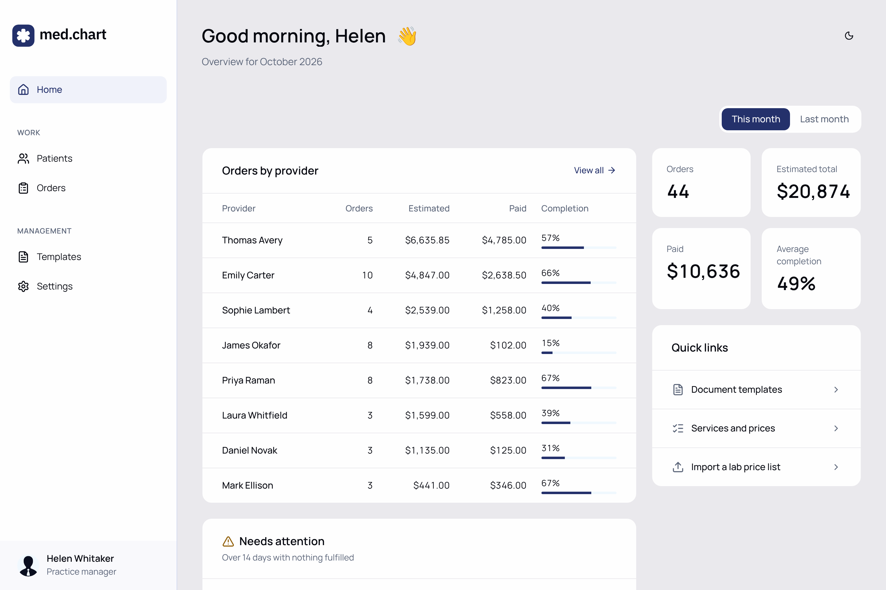
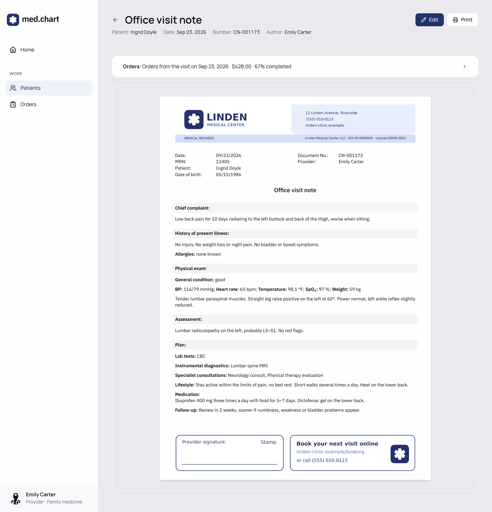
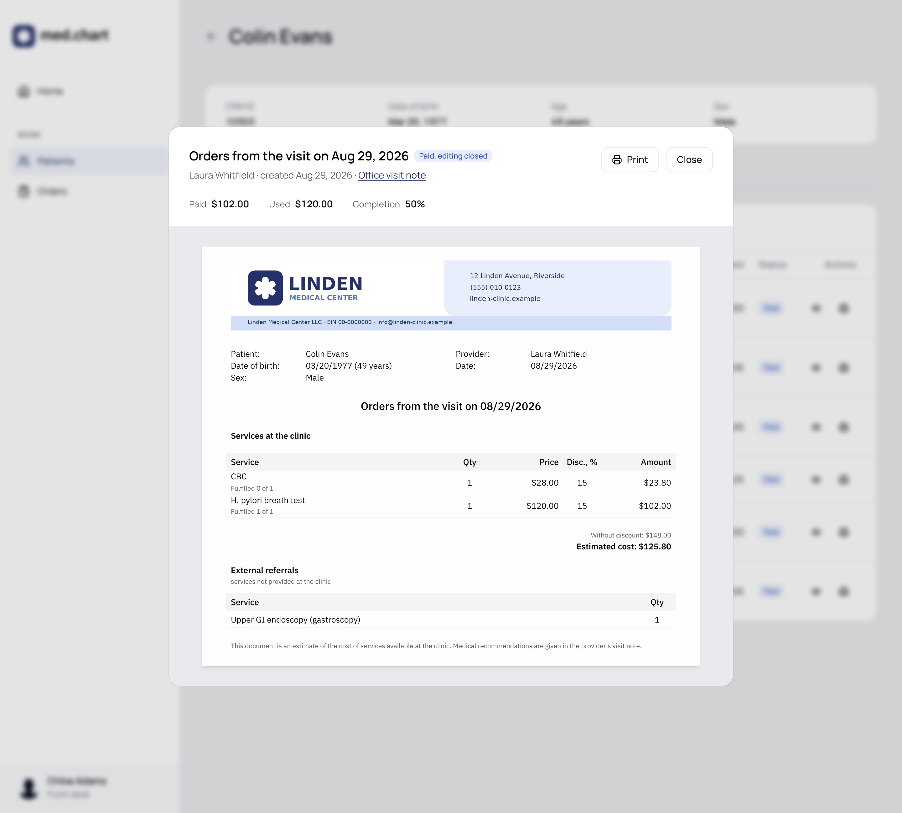
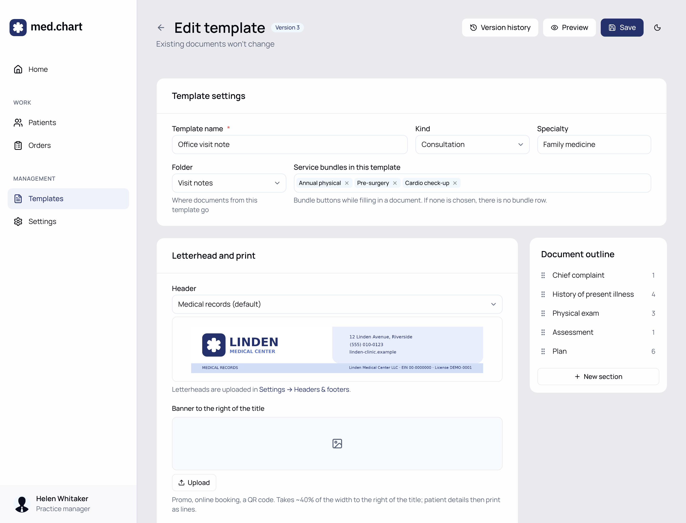
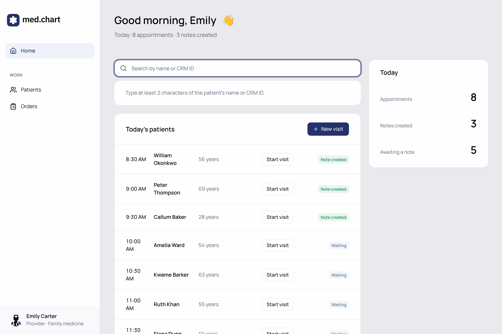

# Clinic EMR — demo

An electronic medical record for a private outpatient practice: providers write visit notes from templates, the
recommended services turn into orders with a cost estimate, the front desk takes payments against them, and the
practice manager sees per-provider analytics. Every document prints on A4 from a modular grid.

**All data in this repository is fictional.** «Linden Medical Center», its staff, patients, letterheads and the two
external laboratories are invented. This is a public copy of a system built for a real clinic, with no client data,
names, addresses or endpoints.



## What it does

- **Visit notes from templates.** A visit starts from today's appointment list and a template; the note is
  filled in inline on the A4 sheet (or as a form), with required fields, dropdowns, groups and service pickers —
  Chief complaint, History of present illness, Physical exam, Assessment and Plan.
- **Orders with cost estimates.** The services recommended in a note become orders: clinic services with
  prices in USD and discounts, plus External referrals (tests the clinic doesn't do, no price). Once anything is paid,
  the orders are locked; completion and payments are tracked per item.
- **Template builder.** Sections, fields, groups, text with variables, images, service blocks and bundles,
  letterheads. Every save is a new version; existing documents keep the version they were written on.
- **Per-provider analytics.** Orders, estimated and paid amounts and average completion per provider for this month
  and last month, plus the orders where nothing has been done for two weeks.
- **A4 print on a modular grid.** Notes are laid out in A4 pages on screen exactly as they print (a long note runs to a
  second page), on a 12-column grid with a 14pt baseline; orders print from the same component as their dialog.
- **Roles.** Practice manager, provider, nurse, front desk and contact center get different home pages and actions:
  providers and nurses write notes, the front desk sees today's orders and can only set discounts, and only the
  practice manager manages templates, settings and deletions.
- **US formats.** One helper (`lib/format.ts`) for every date, time and amount: «Apr 27, 2026», «04/27/2026» on
  documents, «2:24 PM», «$182.00»; vitals in °F.

| Visit note on A4 | Orders |
| --- | --- |
|  |  |

| Template builder | Today's patients |
| --- | --- |
|  |  |

## Stack and architecture

- **Next.js App Router**, TypeScript, **Tailwind CSS v4**, **shadcn/ui** (Base UI), SWR, next-themes (the dark theme is
  for the practice manager).
- **Data layer: `lib/data.ts`.** Components never touch storage: every read and write is a function there. Today it
  works on in-memory mocks; the functions and the snake_case types in `lib/types.ts` mirror database tables, so the
  next step swaps the bodies for Supabase queries without touching components.
- **Template versioning.** A template points to its current `template_version`; a document stores the version it was
  created from and its values by field id, so editing a template never rewrites history.
- **Document grid.** A4 sheets share one set of tokens (`--doc-line`, `--doc-cols`, `--doc-gutter` in
  `app/globals.css`) and grid components (`components/document-sheet`): margins, section bars, tables and images all
  snap to whole or half lines. `PagedSheet` measures every piece and lays the note out page by page.
- **Demo data: `lib/demo/generate.ts`.** A seeded generator builds six months of clinic life relative to today:
  12 staff, 60 patients, ~90 services in USD with two external labs, 6 service bundles, 8 templates (some with 2–3
  versions), ~220 visit notes and ~200 orders from 35 clinical scenarios (chief complaint → physical exam → assessment →
  plan), payments, uploaded lab results and an activity log. Patients follow coherent episodes — a PCP
  suspects hypothyroidism, the radiologist scans the thyroid, the endocrinologist starts and then adjusts
  treatment — and providers differ in how often their patients complete their orders.

## Run locally

```bash
pnpm install
NEXT_PUBLIC_DEMO=1 pnpm dev
```

Open http://localhost:3000. `NEXT_PUBLIC_DEMO=1` adds «Sign in as…» to the profile menu at the bottom of the sidebar,
so you can switch between staff members and see the app as a provider, a nurse, the front desk or the practice
manager. Without it, the app opens as the practice manager.

`pnpm build` builds for production. Data lives in memory, so changes reset on reload.

## Roadmap

- **Supabase + row-level security**: the same `lib/data.ts` API on Postgres, with access rules per role.
- **CRM sync**: appointments, services and payments from the clinic's CRM instead of the cached mocks.
- **AI transcription into template fields**: record the visit and let a model fill in the fields, guided by each
  field's description in the template.
- **Lab results module**: structured results from the external laboratories, on the same document grid.
